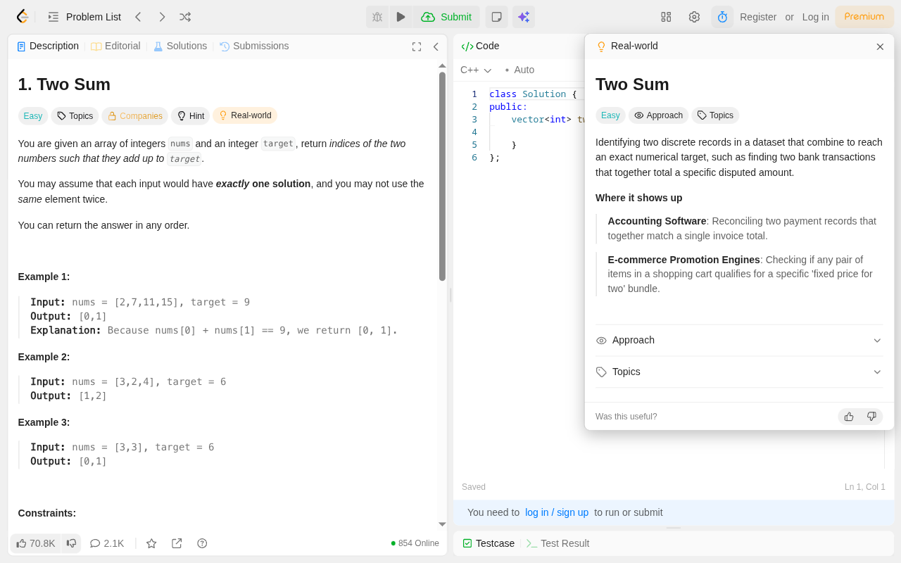
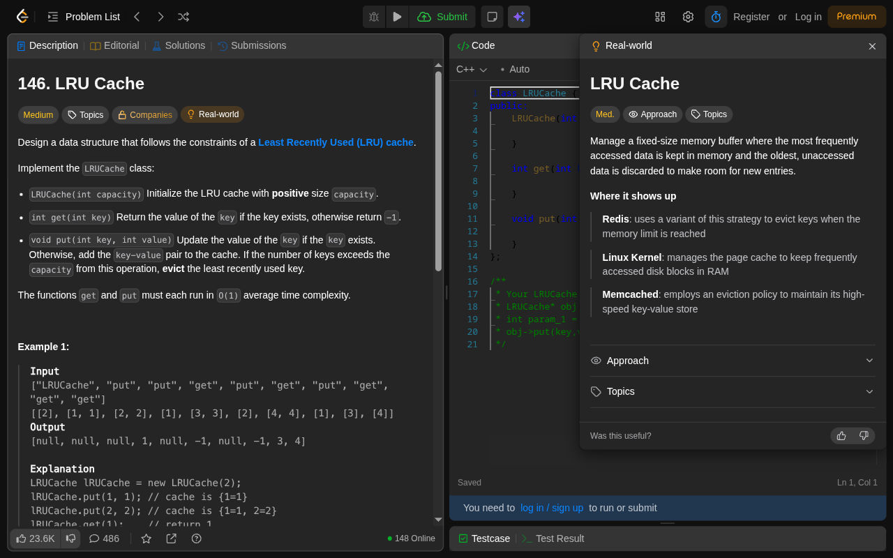
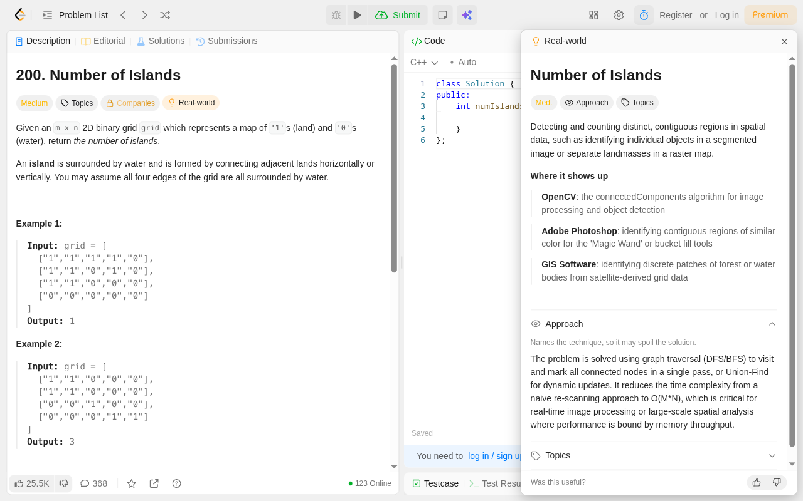

<p align="center">
  
</p>

<h1 align="center">AlgoBridge</h1>
<p align="center"><strong>See where the algorithms you practice show up in real systems.</strong></p>
<p align="center">A Chrome extension that adds real-world context to LeetCode problems—without leaving the page.</p>



## From practice problem to practical use

Why learn LRU caches? Where does graph traversal actually help? AlgoBridge puts those connections beside the problem you're solving.

- **Real-world applications:** explore practical use cases and examples of systems using related ideas.
- **Approach, when you're ready:** algorithm details stay collapsed until you choose to open them. They can spoil the solution.
- **Familiar interface:** a panel that follows LeetCode's light and dark themes.
- **Quick access:** click the **Real-world** chip, the extension's toolbar icon, or press **Alt+Shift+A**.
- **Local feedback:** mark explanations helpful or unhelpful; votes are saved in your browser.

Explanations are AI-generated and may be inaccurate. Treat named systems as learning examples, not verified implementation documentation. AlgoBridge is an independent project, not affiliated with LeetCode.

### At home in dark mode



<details>
<summary>See the optional approach explanation</summary>



</details>

## Try it locally

Chrome Web Store publication is still pending. To install from source, use Node.js 22 or newer and npm:

```bash
git clone https://github.com/cgaswin/algobridge.git
cd algobridge
npm ci
npm run build
```

1. Open `chrome://extensions` and enable **Developer mode**.
2. Click **Load unpacked** and select `.output/chrome-mv3` in this repository.
3. Open a [LeetCode problem](https://leetcode.com/problems/two-sum/description/) and click **Real-world**.

The checked-in production configuration uses the hosted AlgoBridge API. A first request may take longer if the service is waking up. No personal AI API key is needed in the extension.

## Data and permissions

When requesting an explanation, the extension sends the current problem URL to the AlgoBridge API. The backend uses AI services to generate explanations. Helpfulness votes are stored locally in Chrome, not sent to the backend.

The extension requests `storage` for local feedback and access to its API host for explanations. Its content script runs on LeetCode pages (`leetcode.com` and `www.leetcode.com`), with the chip and panel used on problem pages. See the [backend repository](https://github.com/cgaswin/algobridge-api) for server-side behavior. A published privacy policy and matching store disclosures are required before store submission.

## Development

```bash
npm ci
npm run dev
```

WXT starts the development server. Load `.output/chrome-mv3-dev` as an unpacked extension in Chrome; for `npm run dev:firefox`, load `.output/firefox-mv2-dev/manifest.json` as a temporary add-on from `about:debugging`. WXT 0.21 makes the browser launcher optional; this project leaves it uninstalled to avoid its remaining dependency advisories, so browsers no longer open automatically.

Development requests default to `http://localhost:8000`; run the [backend](https://github.com/cgaswin/algobridge-api) locally, or override the API URL.

| Variable | Purpose |
| --- | --- |
| `WXT_PROBLEM_INSIGHTS_API_BASE_URL_DEV` | Development API URL |
| `WXT_PROBLEM_INSIGHTS_API_BASE_URL_PROD` | Production API URL; set in `.env.production` to the hosted API |
| `WXT_PROBLEM_INSIGHTS_API_BASE_URL` | Shared fallback when a mode-specific URL is absent |
| `WXT_SCENARIO_PROVIDER_MODE` | `remote` (default) or `dummy` for fixture data |

Without an environment override, the API URL falls back to `http://localhost:8000`. These are build-time settings: rebuild after changing them. Do not put secrets in `WXT_` variables; they are bundled into the extension.

### Commands

| Command | Purpose |
| --- | --- |
| `npm run test` | Unit tests |
| `npm run compile` | TypeScript check |
| `npm run build` | Chrome production build |
| `npm run zip` | Build a Chrome upload ZIP in `.output/` |
| `npm run dev:firefox` | Firefox development |
| `npm run build:firefox` | Firefox build; not a claim of store readiness |

### Code map

Built with **WXT / Manifest V3**, **React**, **TypeScript**, **Tailwind CSS v4**, and **Vitest**.

- `entrypoints/background.ts` — toolbar and shortcut actions, API request relay, welcome page.
- `entrypoints/content.tsx` — shadow-root mounts for the inline chip and panel.
- `entrypoints/welcome/` — onboarding.
- `src/ui/overlay/` — panel, loading/error states, theme and placement.
- `src/features/scenario/` — remote API and fixture providers.
- `src/features/feedback/` — local helpfulness votes.
- `public/icon/` — editable SVG artwork and Chrome PNG icons.
- `docs/store/` — store screenshots, promo tile, and submission checklist.

## Before a release

Run `npm run test`, `npm run compile`, and `npm run zip`, then load the resulting build in Chrome. Check onboarding, all three ways to toggle the panel, Escape dismissal, light/dark themes, problem-to-problem navigation, feedback persistence, and the retry state when the API is unavailable. Clicking the toolbar outside LeetCode should open onboarding.

See the [Chrome Web Store checklist and assets](docs/store/README.md) for submission steps. Report bugs or inaccurate examples through [GitHub Issues](https://github.com/cgaswin/algobridge/issues).

## License

[GNU Affero General Public License v3.0](LICENSE)
